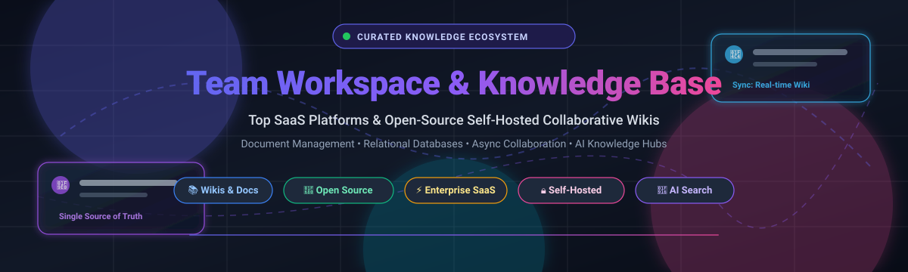

# Awesome-Team-Workspace-Knowledge-Base 📚🚀

  

  
  
  
  
  
  

> 🌟 A curated list of leading **Team Workspaces, Knowledge Bases, Collaborative Wikis, and Documentation Hubs**. Discover top SaaS solutions and self-hosted open-source alternatives to eliminate documentation silos and streamline team collaboration.

---

## 🧭 Top Team Workspace & Knowledge Base Ecosystem

**Curated List of SaaS Products & Open-Source GitHub Projects** 📖⚡  
*Focused on Collaborative Wikis, Documentation Platforms & Self-Hosted Knowledge Bases*  

**Last updated: October 2026** 📅

This repository tracks notable **SaaS platforms** and **open-source projects** for **Team Workspace & Knowledge Base**. These tools enable teams to capture, organize, and share institutional knowledge—from meeting notes and process documentation to product specs and onboarding guides—reducing information silos and keeping everyone aligned on a single source of truth.

🏆 **Examples** include Microsoft SharePoint, Confluence (Atlassian), Notion, ClickUp Docs, Basecamp, Coda, Guru, Slab, Slite, and Nuclino.

💡 **Open-source emphasis**: Team Workspace & Knowledge Base is a domain where open-source tooling is **mature and genuinely competitive for core documentation workflows**. **AppFlowy** and **AFFiNE** lead as visual and block-based Notion alternatives with canvas capabilities. **Outline** provides a polished, Notion-like wiki with a mature editor and API ecosystem. **Wiki.js** offers a developer-centric wiki with multi-database support. **Docmost** stands out as an open-source Confluence/Notion alternative with real-time collaboration, diagrams (Draw.io, Excalidraw, Mermaid), spaces, and permissions. **BookStack** provides an opinionated, structured documentation hierarchy (books/chapters/pages) built on PHP/Laravel. The critical caveat: **enterprise-grade permissions, audit trails, and SSO** are often where open-source tools require self-hosted management and maintenance, whereas commercial platforms deliver turnkey enterprise governance.

🤝 Contributions welcome! Open a PR to add/update entries. Keep descriptions factual and link to official sites.

---

## 📑 Table of Contents

- [📊 Sector Overview & Market Dynamics](#-sector-overview--market-dynamics)
- [☁️ SaaS/Hosted Platforms](#️-saashosted-platforms)
- [💻 Open-Source GitHub Projects](#-open-source-github-projects)
- [🤝 How to Contribute](#-how-to-contribute)
- [⭐ Star History](#star-history)
- [💖 Support](#-support)
- [⚠️ Disclaimer](#️-disclaimer)

---

## 📊 Sector Overview & Market Dynamics

The global knowledge management and team collaboration software market is estimated at approximately **$30 billion to $35 billion in 2025–2026**, expanding at a 12–14% CAGR driven by remote/hybrid team operations and the rapid adoption of enterprise AI search and agentic memory layers. The sector is **moderately fragmented**: mega-cap enterprise suites like Microsoft 365 (SharePoint) and Atlassian (Confluence) control extensive legacy enterprise footprints, while nimble, product-led horizontal platforms (Notion, ClickUp, Coda) and AI-first knowledge hubs (Slite, Guru) aggressively capture fast-growing startups and digital-native businesses.

---

## ☁️ SaaS/Hosted Platforms

The table below compares category leaders, sorted descending by company scale (market capitalization or latest enterprise valuation).

| 🏢 Platform | 💰 Scale (Valuation / Revenue) | 🏷️ Starting Tier Pricing | 🎁 Free Tier Limits | 📝 Description & Key Capabilities |
| :--- | :--- | :--- | :--- | :--- |
| **[Microsoft SharePoint](https://www.microsoft.com/en-us/microsoft-365/sharepoint/collaboration)** | **~$3.1 Trillion** (Market Cap) | $5.00/user/month (SharePoint Plan 1) | No permanent free plan; 30-day free trial of Microsoft 365 Business Basic (up to 25 user licenses with 1 TB cloud storage per user) | Enterprise collaboration and document management powerhouse within Microsoft 365; deep Office/Teams synergy, advanced compliance, and intranet portals. |
| **[Confluence](https://www.atlassian.com/software/confluence)** (Atlassian) | **~$45 Billion** (Market Cap) | $6.05/user/month (Standard plan) | Free forever for up to 10 users with 2 GB total file storage, unlimited spaces, and community support | Atlassian's industry-standard team workspace and documentation platform; deep Jira integration, rich page templates, and granular access controls. |
| **[Notion](https://www.notion.com/)** | **~$10 Billion** (Valuation) | $10.00/user/month ($8/user/mo billed annually - Plus plan) | Free forever for individuals with up to 10 guest collaborators, unlimited pages/blocks for personal use (limited block trial for 2+ members), and 5 MB file upload cap | Highly flexible all-in-one workspace uniting wikis, docs, relational databases, and task boards with extensive template systems and AI assistant capabilities. |
| **[ClickUp Docs](https://clickup.com/features/docs)** | **~$4 Billion** (Valuation) | $10.00/user/month ($7/user/mo billed annually - Unlimited plan) | Free forever with 100 MB storage limit, unlimited members, unlimited docs, and collaborative editing (feature-capped after 100 uses on advanced views) | Unified workspace embedding wikis and documentation directly alongside sprint tasks, milestones, custom fields, and real-time collaboration. |
| **[Coda](https://coda.io/)** | **~$1.4 Billion** (Valuation) | $12.00/Doc Maker/month ($10/Doc Maker/mo billed annually - Pro plan; Editors and viewers are free) | Free forever with unmetered Doc Makers, up to 50 objects per doc, 500 rows per table, and 10 MB total document size | Document-spreadsheet-app hybrid that transforms team wikis into interactive internal tools and automated workflows without dedicated programming. |
| **[Guru](https://www.getguru.com/)** | **~$600 Million** (Valuation) | $18.00/user/month ($15/user/mo billed annually - All-in-One plan) | Free forever for up to 3 users with core verified knowledge cards, web app & browser extension; 30-day unlimited trial for larger teams | AI-driven enterprise search and verified knowledge management system delivering contextual knowledge directly into browser extensions, Slack, and Zendesk. |
| **[Basecamp](https://basecamp.com/)** | **~$100 Million** (ARR scale) | $15.00/user/month (Basecamp standard; or $299/month flat for unlimited users on Basecamp Pro Unlimited) | No permanent free plan; 30-day fully functional free trial with unlimited users, projects, and message boards (no credit card required) | Opinionated, clutter-free project communication and team hub featuring message boards, campfire chats, to-do lists, docs, and scheduling in one simple interface. |
| **[Slab](https://slab.com/)** | **~$40 Million** (Valuation) | $8.00/user/month ($6.67/user/mo billed annually - Startup plan) | Free forever for up to 10 users with 90-day search history limit and 10 MB file upload limit | Streamlined knowledge base and team wiki with a focused real-time block editor, unified search across external tools, and intuitive topic hierarchies. |
| **[Slite](https://slite.com/)** | **~$25 Million** (Valuation) | $10.00/user/month ($8/user/mo billed annually - Standard plan) | Free forever for up to 50 docs with unlimited members, 1 team space, and 100 MB file storage | Modern AI-centric knowledge base equipped with document verification cadences, agentic search, and automated formatting for fast-moving teams. |
| **[Nuclino](https://www.nuclino.com/)** | **~$15 Million** (Valuation) | $6.00/user/month ($5/user/mo billed annually - Standard plan) | Free forever for up to 50 items/docs and 2 GB total storage with unlimited team members | Fast, lightweight collaborative workspace prioritizing instant search, graph visualization, and intuitive hierarchical page structures. |

---

## 💻 Open-Source GitHub Projects

Explore the most popular self-hosted, privacy-first, and community-driven knowledge base alternatives. Entries are sorted descending by GitHub Stars_Counts.

| 📦 Repository | ⭐ GitHub_Stars | 📜 License | 🛠️ Primary Tech Stack | 📌 Description & Key Strengths |
| :--- | :--- | :--- | :--- | :--- |
| **[AppFlowy](https://github.com/appflowy-io/appflowy)** |  | AGPL-3.0 | Flutter / Rust | Leading privacy-first open-source Notion alternative. Offers offline-first document editing, kanban boards, relational grids, and self-hosted synchronization. |
| **[AFFiNE](https://github.com/toeverything/AFFiNE)** |  | MIT | TypeScript / Rust | Next-generation workspace fusing block documents, whiteboards, and infinite canvases (Notion + Miro hybrid) with multi-modal AI and local-first data sync. |
| **[Logseq](https://github.com/logseq/logseq)** |  | AGPL-3.0 | ClojureScript / Rust | Privacy-first, local-first outliner and knowledge graph supporting Markdown and Org-mode, bi-directional linking, whiteboards, and PDF annotation. |
| **[Outline](https://github.com/outline/outline)** |  | BSL 1.1 | TypeScript / React / Node.js | Beautiful, fast collaborative wiki designed for growing teams. Features a clean Markdown-compatible block editor, enterprise SSO/OIDC integration, and rich APIs. |
| **[Wiki.js](https://github.com/requarks/wiki)** |  | AGPL-3.0 | Node.js / Vue / PostgreSQL | Highly extensible modern wiki engine with modular authentication, multi-engine document rendering (Markdown, Visual, Code), and bi-directional Git sync. |
| **[Docmost](https://github.com/docmost/docmost)** |  | AGPL-3.0 | TypeScript / NestJS / Vue | Modern open-source Confluence and Notion alternative featuring real-time multiplayer collaboration, diagramming (Excalidraw, Draw.io, Mermaid), and space-level permissions. |
| **[BookStack](https://github.com/BookStackApp/BookStack)** |  | MIT | PHP / Laravel / MySQL | Opinionated, beginner-friendly documentation platform organized hierarchically into Shelves, Books, Chapters, and Pages with built-in authentication and revision history. |
| **[HedgeDoc](https://github.com/hedgedoc/hedgedoc)** |  | AGPL-3.0 | TypeScript / Node.js | Real-time collaborative Markdown editor and presentation platform supporting live syntax previews, math typography, diagramming, and permissions. |
| **[XWiki](https://github.com/xwiki/xwiki-platform)** |  | LGPL-2.1 | Java / JavaScript | Enterprise-grade extensible wiki and application platform providing structured data forms, fine-grained access rights, workflow extensions, and Confluence migration tools. |

---

## 🤝 How to Contribute

1. 🍴 Fork this repository.
2. ✍️ Add or update entries in `README.md` adhering to the table format and metadata requirements.
3. 🔗 Ensure all links point directly to official sites or repositories, and verify license terms and pricing tiers.
4. 🚀 Submit a Pull Request with a clear, concise description of your changes.

---

##  Star History

---

## 💖 Support

Thank you for exploring this curated repository! If you find this resource valuable for benchmarking or architecting your team's knowledge management setup, please consider:

- ⭐ **Starring** the repository to support visibility.
- 🍴 **Forking** it to customize your team's internal evaluations.
- 📢 **Sharing** with colleagues, engineering managers, and developer communities.
- ☕ **Buying a coffee** to sponsor ongoing curation: 

---

## ⚠️ Disclaimer

- This list is community-curated for informational and architectural evaluation purposes; inclusion does not constitute commercial endorsement.
- Verify software licensing terms before commercial self-hosting: AppFlowy and Docmost utilize AGPL-3.0 (with enterprise license models for commercial add-ons), Outline operates under BSL 1.1, and BookStack and AFFiNE use permissive MIT licenses.
- When self-hosting organizational knowledge bases, maintain rigorous security controls, automated offsite database backups, SSO/MFA policies, and data retention configurations to safeguard internal documentation.

---

**Built with ❤️ for engineering leaders, knowledge managers, documentation specialists, and dev teams architecting seamless collaboration hubs.**
